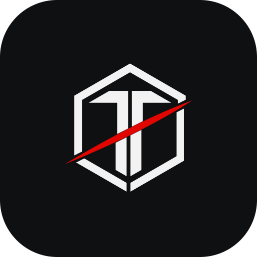

# Trafitto Launcher



[Sito del progetto](https://trafitto.com/trafitto-launcher/)

> [!IMPORTANT]
> **This is an unofficial, personal fork of [Kvaesitso](https://github.com/MM2-0/Kvaesitso), customized
> for my own use.** It is not affiliated with, endorsed by or supported by MM2-0 or the Kvaesitso
> project. All the credit for the launcher goes to MM2-0 and the Kvaesitso contributors.
> Please don't report problems of this fork to the original project.
>
> *Fork personale e non ufficiale di Kvaesitso, personalizzata per uso mio. Non è affiliata al
> progetto originale: tutto il merito del launcher va a MM2-0 e ai contributori di Kvaesitso.*

## Changes from Kvaesitso

- Renamed to **Trafitto Launcher**, with its own logo and package name (`it.trafitto.launcher`), so it
  installs next to the official Kvaesitso
- **Swipe right:** full screen week calendar
- **Swipe left:** widget pages for app widgets (one by default, more from the settings)
- **Home, your way:** up to 6 pinned apps, nothing but the clock, or letters on the screen edge:
  slide on them to see the apps of each letter and open one
- **Search bar:** at the bottom, opened by swiping up, rounded and resizable
- **Apps by category:** the app list is split in sections (Communication, Games, Tools…), created
  from the type of each app. Newly installed apps land in their category by themselves, if it still
  exists. Every section can be renamed, filled or emptied
- **Optional, off by default:** the latest notification under each home app, and a side swipe on a
  home app for its shortcuts
- **Snappier:** icons shrink a little when pressed and fade in when loaded, apps launched with enter
  from search open from their icon, smaller and faster release build (R8 optimization on)
- **Lighter on battery:** the home draws nothing while idle, no charging animation, the clock
  updates once a minute (unless it shows seconds), no full screen offscreen layers while the
  keyboard animates, exchange rates updated once a day and background updates only with network

### Make it yours

Everything added by this fork can be changed from the settings:

| Where | What you can change |
|---|---|
| Settings › Home screen › Apps on home screen | What the home shows: pinned apps (up to 6), no apps, or letters on the edge |
| | Pinned apps: position (top or bottom; left, center or right), names and icons on or off, text size, bold, icon size and shape, black and white icons, spacing. Add apps with "+ Add app" or by long pressing an app on the home |
| | Notifications under apps (off by default) |
| | Swipe an app for its shortcuts (off by default: starting on an app, a side swipe no longer opens widgets or calendar) |
| Settings › Home screen › Search bar | Height, width, corner roundness, glass effect |
| Settings › Home screen › Widgets | Number of widget pages |
| Settings › Search › Apps › Group by category | App list split in sections, on by default |
| App list | Tap the pencil on a section title to rename it or to add and remove apps; "+ New category" at the end of the list |

On top of that, everything Kvaesitso already lets you change: colors and themes, icon packs, clock
styles, gestures, wallpaper dim and blur ([user guide](https://kvaesitso.mm20.de/docs/user-guide)).

### Measured on a OnePlus Nord

Performance and battery matter as much as features: the launcher runs all day, on a phone from 2020.
Features that cost something at rest or change a gesture are off by default.

| Situation | CPU | Frames drawn |
|---|---|---|
| Home idle, on battery or charging | 1–5 ms/s | 0 fps |
| In the background | ~1 ms/s | |
| Search: open, scroll, close | ~160 ms/s | |
| Memory (PSS) | 136–141 MB | |

OnePlus Nord, Android 12: CPU of all the launcher's processes and frames rendered, 60 seconds per
situation. 1 ms of CPU per second is 0.1% of one core. Opening and closing search is still the
heaviest part (translucent cards over the wallpaper at 90 Hz) and the next thing to lighten.

Licensed under the GPL-3.0, like the original. Everything below is the original Kvaesitso readme.

---

# Kvaesitso


Kvaesitso is a search focused, free and open source launcher for Android.

[Website and documentation](https://kvaesitso.mm20.de)

## Installation

Kvaesitso can be installed on Android devices running Android 8.0 or higher, but a Google Pixel
device running Android 11 or higher is recommended for the best experience.

### Using an F-Droid client and MM20's repo

The preferred way of installation is using the [F-Droid](https://f-droid.org) application. That way
you will always be notified about updates. Kvaesitso is available in the official F-Droid
repository, but all features depending on non-foss external APIs were removed.
For feature-complete builds you can add [MM20's repository](https://fdroid.mm20.de). Just scan the
code below or open
the link on your phone:


https://fdroid.mm20.de/repo/

The same version is also available
in [IzzyOnDroid's repository](https://apt.izzysoft.de/fdroid/index/apk/de.mm20.launcher2.release).

### Manual installation

You can also download the latest release from
the [releases page](https://github.com/MM2-0/Kvaesitso/releases/latest) and install it manually.

## Report issues

If you notice any bugs or issues create a new issue in
the [issue tracker](https://github.com/MM2-0/Kvaesitso/issues). Before you do, please search the
existing issues for any similar issues. Please include any relevant information such as steps to
reproduce, stack traces, logs, and device information. These information can be founder under
Settings > Debug > Crash reporter and Settings > Debug > Export debug information.

## Feature requests

If you have an idea for a new feature, just create a new issue. However, there is no guarantee that
they will be implemented.

## Contribute

Contributions are always welcome. If you want to fix any existing issues just create a new pull
request. If you plan to implement any (bigger) new features, please
create an issue first so we can discuss if and how this feature should be implemented.

If you want to help translating,
see [how to translate the project.](https://kvaesitso.mm20.de/docs/contributor-guide/i18n)

<a href="https://i18n.mm20.de/engage/kvaesitso/">

</a>

## Links

- User guide: https://kvaesitso.mm20.de/docs/user-guide
- F-Droid-Repository: https://fdroid.mm20.de

## Thanks to

- [@EliotAku](https://github.com/EliotAku) for the app icon
- All [translators and code contributors](https://github.com/MM2-0/Kvaesitso/graphs/contributors)

## License

This software is free software licensed under the GNU General Public License 3.0.

```

Copyright (C) 2021–2026 MM2-0 and the Kvaesitso contributors

This program is free software: you can redistribute it and/or modify
it under the terms of the GNU General Public License as published by
the Free Software Foundation, either version 3 of the License, or
(at your option) any later version.

This program is distributed in the hope that it will be useful,
but WITHOUT ANY WARRANTY; without even the implied warranty of
MERCHANTABILITY or FITNESS FOR A PARTICULAR PURPOSE.  See the
GNU General Public License for more details.

You should have received a copy of the GNU General Public License
along with this program.  If not, see <https://www.gnu.org/licenses/>.
```

The plugin SDK modules (`plugins/sdk` and `core/shared`) are licensed under the Apache License 2.0.
